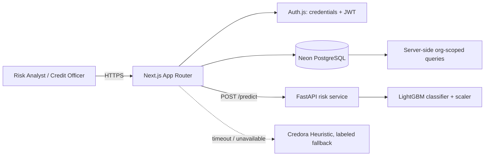
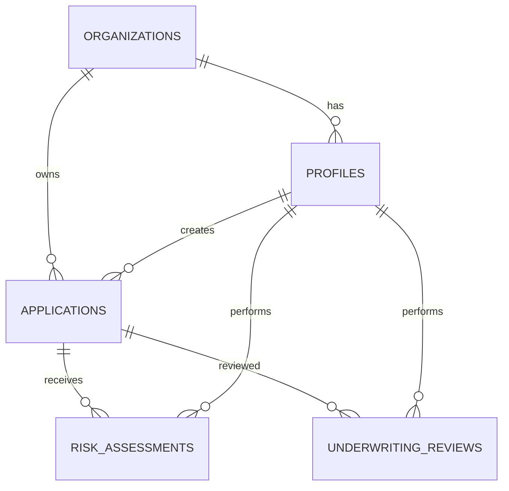

# Credora: A Credit-Risk Intelligence Platform for PayLater Lending

> **Smarter Credit. Better Decisions.**

| Field | Detail |
|---|---|
| Product | Credora — Credit Intelligence Platform |
| Version | 0.1.0 (minimum viable product) |
| Domain | Financial Technology (FinTech) — Credit Risk Intelligence |
| Primary users | Risk Analysts and Credit Officers at PayLater providers (B2B) |
| Development status | Implemented prototype; model validity not yet established |
| Document date | November 2026 |

---

## Abstract

PayLater providers must process large volumes of credit applications, estimate the likelihood of default, and monitor aggregate portfolio risk. In many organizations these activities are distributed across disconnected tools, which obscures the rationale of risk estimates and complicates manual review. This document presents Credora, an applied web platform that integrates credit application management, machine-learning risk assessment, portfolio analytics, and underwriting review in a single system. The platform is implemented with Next.js 16, React 19, TypeScript, Tailwind CSS, and PostgreSQL hosted on Neon; authentication is provided by Auth.js with organization-scoped authorization enforced at the server layer. Risk scores are produced by a FastAPI service wrapping a pre-trained LightGBM classifier with 22 input features and three decision bands, with a transparent heuristic serving as an explicitly labeled fallback when the service is unavailable. The delivered MVP comprises ten pages covering the full analyst workflow, a reproducible database migration pipeline, containerized deployment for the scoring service, and an automated test suite. Reported classifier metrics from the upstream project (accuracy 93.01%, ROC-AUC 0.9476) are contextualized rather than treated as evidence of operational readiness: the model was trained on USD-scale data, has not been validated on labeled Indonesian PayLater data, and its outputs are advisory only. Future work centers on statistical validation, calibration, fairness assessment, and external data integration.

**Keywords:** credit risk, machine learning, LightGBM, PayLater, fintech, underwriting, portfolio analytics, Next.js, explainable AI

---

## 1. Introduction

### 1.1 Background

Buy-now-pay-later and PayLater services extend short-term credit to consumers who frequently lack conventional credit files. Evaluating such applicants requires structured collection of application data, an estimate of default probability, interpretable evidence for that estimate, and a recorded human decision. Commercial solutions such as Experian, Zest AI, and Taktile address portions of this workflow, but a compact, transparent integration of all four stages remains useful as a teaching and prototyping artifact [1–3].

### 1.2 Problem Statement

The MVP addresses five linked problems:

1. Credit application data are not maintained in a single, queryable system.
2. Officers lack decision support for estimating default risk.
3. Risk estimates are often presented without the factors that produced them.
4. Aggregate portfolio risk is difficult to monitor from application-level records.
5. Review outcomes and final decisions are not recorded in a consistent, auditable form.

### 1.3 Objectives

The project pursues four objectives: (O1) centralize credit application management; (O2) deliver an interpretable machine-learning risk assessment; (O3) summarize portfolio-level risk distributions and trends; and (O4) support and record human underwriting review.

### 1.4 Scope and Delimitations

Included in the MVP: authentication and role-based access, application creation and search, assessment history, portfolio dashboards, review notes, and final decision logging. Excluded by design: B2C self-assessment, direct bank or marketplace integrations, automated external data collection, in-dashboard model retraining, automatic threshold optimization, and automated lending decisions. The system therefore augments—rather than replaces—the credit officer.

### 1.5 Contributions

The repository contributes (i) an end-to-end reference architecture spanning a serverless Next.js application, Neon PostgreSQL, and a containerized Python inference service; (ii) a schema aligned to the 22-feature model contract with organization-level data isolation; (iii) an honest fallback strategy that labels heuristic results rather than silently substituting them; and (iv) reproducible migration, validation, and smoke-test procedures.

---

## 2. Related Work and Positioning

| Platform | Primary emphasis | Relevance to Credora |
|---|---|---|
| Experian [1] | Credit decisioning and scoring | Establishes the decisioning problem context |
| Zest AI [2] | AI underwriting, portfolio risk | ML-based assessment and monitoring |
| Taktile [3] | Risk decisioning strategy | Workflow and policy management |
| Qredi [4] | Alternative scoring for Indonesian MSMEs | Local market and feature relevance |
| CBI Polaris [5] | Model development and monitoring | Validation and governance requirements |

Credora does not claim novelty in scoring methodology or market coverage. Its positioning is deliberately narrow: an integrable MVP that joins application handling, individual risk explanation, portfolio monitoring, and manual review, with validation gaps stated explicitly [6].

---

## 3. Methodology

### 3.1 Development Design

Development followed a staged documentation-and-implementation sequence recorded in `docs/`: idea validation (Step 0), product requirements (Step 1), personas and flows (Step 2), wireframes (Step 3), database schema (Step 4), design system (Step 5), and technology/backend setup (Step 6). Architecture and compatibility checks preceded implementation of the ML integration.

### 3.2 System Architecture



The scoring service is stateless and optional: if `ML_SERVICE_URL` is unset or unreachable, the application returns a transparent heuristic assessment so that evaluations never fail hard.

### 3.3 Technology Stack

| Layer | Technology |
|---|---|
| Application framework | Next.js 16.4.5 (App Router), React 19.3, TypeScript 5 |
| Styling | Tailwind CSS 4 |
| Database | PostgreSQL on Neon (pooled runtime, direct migrations) |
| Authentication | Auth.js / NextAuth 5 (credentials + JWT) |
| Authorization | Application/server layer using `organization_id` and `role` |
| ML runtime | Python, FastAPI, LightGBM, scikit-learn, pandas, joblib |
| Testing | Vitest 5 (TypeScript), `validate_model.py`, `smoke_test.py` |
| Tooling | ESLint 9, tsx, Docker, Git/GitHub |

### 3.4 Data Model

All primary keys are UUIDs and all timestamps are `TIMESTAMPTZ`. Auth.js owns `users`, `accounts`, `sessions`, and `verification_tokens`; the application owns `profiles`, `organizations`, `applications`, `risk_assessments`, and `underwriting_reviews`. Neon does not provide built-in row-level security, so every query filters on the session's `organization_id`.



`risk_assessments` preserves a history of predictions; `underwriting_reviews` records reviewer notes, final decision, and rationale. The `applications` fields mirror the 22-feature model contract, including `loan_grade`, `cb_person_cred_hist_length`, and `cb_person_default_on_file` [6].

### 3.5 Risk Assessment Model

The upstream classifier [7, 8] consumes 22 constructed features: seven numeric applicant/loan variables, three home-ownership indicators, five loan-purpose indicators, six loan-grade indicators, and one historical-default flag. The service scales inputs, computes `predict_proba`, and returns SHAP-style per-feature contributions. Decisions use two thresholds:

| Probability | Category | Service decision |
|---|---|---|
| `< 0.35` | Low Risk | `approve` |
| `0.35 – 0.70` | Medium Risk | `review` |
| `> 0.70` | High Risk | `reject` |

The TypeScript adapter groups the 22 contributions into five human-readable factors and converts IDR monetary values before inference. Because the model was trained on USD-scale data (mean income ≈ $66k), `ML_IDR_PER_USD` (default `4000`) is a **calibration factor, not a real exchange rate**.

### 3.6 Authentication and Authorization

Credentials are hashed with bcryptjs; sessions use Auth.js JWT strategy. Roles are `Risk Analyst` and `Credit Officer`. Data isolation relies on server-side `organization_id` filtering in route handlers rather than database RLS; credentials and connection strings are never exposed to the browser.

---

## 4. Results

### 4.1 Implemented Functionality

| Objective | Implemented surface | Route(s) |
|---|---|---|
| O1 — Application management | Create, search, filter, detail, status tracking | `/applications`, `/applications/new`, `/applications/[id]` |
| O2 — Risk assessment | Model/heuristic scoring, probability, factors, history | `/applications/[id]/assessment` |
| O3 — Portfolio analytics | KPI cards, risk distribution, application trend | `/dashboard`, `/portfolio` |
| O4 — Underwriting review | Review queue, notes, final decision, rationale | `/underwriting`, `/underwriting/[id]` |
| Access & administration | Sign-in, registration, profile, organization settings | `/login`, `/register`, `/settings` |

### 4.2 Reported Model Performance

The following figures were reported by the upstream project [6] and are **not** independently reproduced as operational validation in this repository.

| Metric | Reported value |
|---|---|
| Accuracy | 93.01% |
| Default precision | 88% |
| Default recall | 78% |
| F1-score | 0.83 |
| ROC-AUC | 0.9476 |

### 4.3 Verification Procedures

| Check | Command | Purpose |
|---|---|---|
| Unit/integration tests | `npm test` | Payload conversion, auth headers, fallback, thresholds, factor aggregation |
| Lint | `npm run lint` | ESLint static analysis |
| Type check | `npm run typecheck` | TypeScript compilation without emit |
| Model contract | `python ml/validate_model.py` | Artifact and behavior checks against local model files |
| HTTP smoke test | `python ml/smoke_test.py` | Live service health and prediction contract |
| Database check | `npm run db:check` | Schema, connectivity, and record counts |

---

## 5. Discussion

The architecture separates inference from the web application so that model dependencies, scaling, and deployment can evolve independently. Explainability is treated as a functional requirement: SHAP contributions are grouped into labeled factors with direction and relative weight, allowing the reviewer to see which evidence moved a prediction. The heuristic fallback is deliberately named `Credora Heuristic` so that heuristic output is not mistaken for model output. Human authority is preserved by recording the final decision separately from the prediction.

A key engineering limitation is the conversion between IDR storage and USD-scale training data. This permits functional operation but is not a defensible production calibration. Similarly, application-layer authorization is adequate for a single-service MVP but would benefit from defense in depth (database RLS or policy enforcement) as deployment scope grows.

---

## 6. Limitations and Threats to Validity

- **Model validity.** Dataset relevance, leakage, class imbalance, probability calibration, threshold policy, and fairness have not been validated on labeled Indonesian PayLater data.
- **Monetary scale.** Results depend on the calibration factor; retraining on IDR data is required for real decisions.
- **Data provenance.** No sample records are bundled; dashboard figures derive from workspace data entered by authorized users.
- **Decision authority.** Predictions are advisory; the system must not be used for automated credit decisions.
- **Security surface.** Organization isolation is enforced in application code; Neon RLS is optional and not currently configured.
- **Scope.** No external financial data ingestion, B2C assessment, or in-app retraining is implemented.

---

## 7. Conclusion and Future Work

Credora demonstrates that application management, interpretable risk scoring, portfolio monitoring, and human review can be integrated into a coherent MVP. The immediate next steps are statistical validation against labeled data, probability calibration and threshold policy review, fairness evaluation, deployment of the ML service and Next.js application, and—only after those steps—consideration of external data integration.

---

## 8. Reproducibility: Installation and Operation

### 8.1 Prerequisites

- Node.js and npm
- A Neon PostgreSQL project (two connection strings)
- Python 3 with `venv` (only for the ML service)
- Docker (optional, for containerized inference)

### 8.2 Environment Configuration

Copy `.env.example` to `.env.local` and supply:

- `DATABASE_URL` — pooled connection used by the application runtime.
- `DATABASE_URL_UNPOOLED` — direct connection used by migrations.
- `AUTH_SECRET` — generate with `npx auth secret`.
- `AUTH_URL` — application origin (`http://localhost:3000` locally).

### 8.3 Database Setup

```bash
npm install
npm run db:migrate
```

`db:migrate` applies `db/schema.sql`. Optional verification: `npm run db:check`.

### 8.4 Running the Application

```bash
npm run dev
```

Open `http://localhost:3000` and create your organization account at `/register`. No shared credentials or sample accounts are provided.

### 8.5 Machine-Learning Service

```bash
py -m venv ml/.venv
ml\.venv\Scripts\pip install -r ml/requirements.txt
npm run ml:serve
```

The service listens on `http://127.0.0.1:8000` and exposes `/health`, `/model/info`, and `/predict`. Configure the application in `.env.local`:

```bash
ML_SERVICE_URL="http://127.0.0.1:8000"
ML_IDR_PER_USD="4000"
```

### 8.6 Model Validation and Smoke Tests

```bash
ml\.venv\Scripts\python.exe ml/validate_model.py
ml\.venv\Scripts\python.exe ml/smoke_test.py
ML_SERVICE_URL="https://my-service" ML_SERVICE_API_KEY="secret" ml\.venv\Scripts\python.exe ml/smoke_test.py
```

### 8.7 Containerized Inference

```bash
docker build -t credora-ml ml
docker run --rm -p 8000:8000 -e ML_SERVICE_API_KEY=secret credora-ml
```

The image serves on `$PORT` (default `8000`) and includes a `/health` healthcheck. `/predict` and `/model/info` require `Authorization: Bearer $ML_SERVICE_API_KEY` when the key is set; `/health` remains unauthenticated.

---

## 9. Deployment

1. Set `DATABASE_URL`, `DATABASE_URL_UNPOOLED`, `AUTH_SECRET`, and `AUTH_URL` in the hosting environment (for example, Vercel).
2. Run `npm run db:migrate` once against the production database.
3. Keep `AUTH_SECRET` stable across deploys and set `AUTH_URL` to the deployed origin.
4. Deploy the ML service separately and set `ML_SERVICE_URL` and `ML_SERVICE_API_KEY` when model-based scoring is desired.

---

## 10. References

1. Experian. *Credit decisioning and credit scoring.* https://www.experian.com/business/solutions/credit-decisioning
2. Zest AI. *AI-based credit underwriting and portfolio risk management.* https://www.zest.ai/
3. Taktile. *Credit risk decisioning and monitoring.* https://taktile.com/credit-solution
4. Qredi. *Alternative credit scoring for Indonesian MSMEs.* https://www.qredi.id/
5. CBI. *Polaris — risk model development and monitoring.* https://www.cbi.id/product/risk-solutions/polaris/
6. Credora. *Coldstart: consolidated planning document* (`docs/coldstart.md`), 2026.
7. Reinerbroww. *PayLater credit scoring engine* [GitHub repository]. https://github.com/Reinerbroww/paylater-credit-scoring-engine
8. Reinerbroww. *PayLater credit scoring engine* [Streamlit application]. https://paylatercreditscoringengine.streamlit.app/
9. Neon. *Serverless PostgreSQL.* https://neon.com
10. Next.js. *Documentation.* https://nextjs.org

---

## Appendix A — Repository Layout (abridged)

```
src/app/                 App Router pages (auth and dashboard routes)
src/components/          Reusable UI, charts, tables, navigation
src/lib/                 Database, auth helpers, ML adapter, analytics, risk logic
db/schema.sql            PostgreSQL schema
scripts/                 migrate.ts, check.ts
ml/                      FastAPI service, model artifacts, validation scripts, Dockerfile
docs/                    Steps 0–6 planning documents and model artifacts
```

## Appendix B — Environment Variables

| Variable | Required | Purpose |
|---|---|---|
| `DATABASE_URL` | Yes | Pooled Neon connection for runtime queries |
| `DATABASE_URL_UNPOOLED` | Yes | Direct connection for migrations |
| `AUTH_SECRET` | Yes | Auth.js signing secret |
| `AUTH_URL` | Yes (deploy) | Canonical application origin |
| `ML_SERVICE_URL` | No | Enables LightGBM scoring; empty means heuristic fallback |
| `ML_SERVICE_API_KEY` | No | Bearer token expected by the ML service |
| `ML_IDR_PER_USD` | No | Calibration factor (default `4000`) |
| `ML_SERVICE_TIMEOUT_MS` | No | Inference timeout (default `8000`) |
