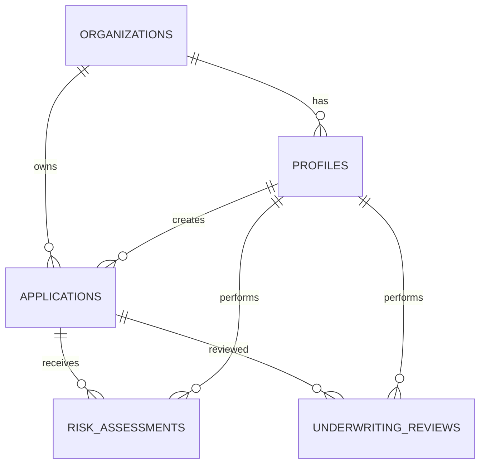

# STEP 4 — DATABASE SCHEMA

**Project:** Credora  
**Database:** PostgreSQL  
**Platform:** Neon  
**Authentication:** Auth.js (NextAuth)  
**Version:** 1.1  
**Status:** Draft

---

## 1. Gambaran Umum

Database Credora dirancang untuk menyimpan informasi organisasi, pengguna, pengajuan kredit, hasil penilaian risiko, dan hasil pemeriksaan petugas.

Database menggunakan PostgreSQL melalui Neon (serverless PostgreSQL). Setiap tabel memiliki primary key dan relasi foreign key untuk menjaga keterhubungan data.

Autentikasi tidak lagi menggunakan Supabase Auth. Credora menggunakan Auth.js (NextAuth) dengan database adapter sehingga tabel `users`, `accounts`, `sessions`, dan `verification_tokens` dikelola oleh Auth.js, sedangkan data profil aplikasi disimpan pada tabel `profiles`.

Neon hanya menyediakan PostgreSQL tanpa layanan auth atau Row Level Security bawaan. Otorisasi data dijalankan pada lapisan aplikasi/server berdasarkan `organization_id`, dan RLS PostgreSQL bersifat opsional (lihat bagian 5).

Schema aktual tersedia di `db/schema.sql` dan diterapkan dengan `npm run db:migrate`. Data demo di-seed dengan `npm run db:seed`, atau keduanya sekaligus dengan `npm run db:setup`.

## 2. Tabel Database

### A. organizations

Menyimpan informasi perusahaan yang menggunakan Credora.

| Kolom | Tipe Data | Keterangan |
|---|---|---|
| id | UUID | Primary Key |
| name | VARCHAR(150) | Nama organisasi |
| created_at | TIMESTAMPTZ | Waktu pembuatan |

### B. users (dikelola Auth.js)

Tabel inti Auth.js untuk akun autentikasi. Struktur mengikuti skema adapter Auth.js (mis. `@auth/pg-adapter`) dan tidak diubah manual. Kolom utama: `id`, `name`, `email`, `emailVerified`, `image`.

Tabel pendukung Auth.js: `accounts`, `sessions`, `verification_tokens`.

### C. profiles

Menyimpan informasi profil aplikasi yang terhubung dengan akun autentikasi Auth.js.

| Kolom | Tipe Data | Keterangan |
|---|---|---|
| id | UUID | Primary Key, Foreign Key ke users.id |
| organization_id | UUID | Foreign Key ke organizations.id |
| full_name | VARCHAR(150) | Nama pengguna |
| role | VARCHAR(30) | Risk Analyst atau Credit Officer |
| created_at | TIMESTAMPTZ | Waktu pembuatan |

### D. applications

Menyimpan informasi pengajuan kredit pelanggan.

| Kolom | Tipe Data | Keterangan |
|---|---|---|
| id | UUID | Primary Key |
| organization_id | UUID | Foreign Key ke organizations.id |
| applicant_name | VARCHAR(150) | Nama pelanggan |
| applicant_email | VARCHAR(150) | Email pelanggan, jika tersedia |
| age | INTEGER | Usia pelanggan |
| person_income | NUMERIC(15,2) | Pendapatan pelanggan |
| employment_length | NUMERIC(5,2) | Lama bekerja |
| loan_amnt | NUMERIC(15,2) | Jumlah pinjaman |
| loan_int_rate | NUMERIC(7,4) | Suku bunga pinjaman, jika tersedia |
| loan_percent_income | NUMERIC(8,4) | Rasio pinjaman terhadap pendapatan |
| home_ownership | VARCHAR(30) | Status kepemilikan tempat tinggal |
| loan_intent | VARCHAR(50) | Tujuan pinjaman |
| status | VARCHAR(30) | Status pengajuan |
| created_by | UUID | Foreign Key ke profiles.id |
| created_at | TIMESTAMPTZ | Waktu pengajuan |
| updated_at | TIMESTAMPTZ | Waktu pembaruan |

### E. risk_assessments

Menyimpan hasil penilaian risiko dari model machine learning.

| Kolom | Tipe Data | Keterangan |
|---|---|---|
| id | UUID | Primary Key |
| application_id | UUID | Foreign Key ke applications.id |
| model_name | VARCHAR(100) | Nama model |
| model_version | VARCHAR(50) | Versi model |
| default_probability | NUMERIC(8,6) | Estimasi probabilitas gagal bayar |
| risk_category | VARCHAR(30) | Kategori risiko |
| contributing_factors | JSONB | Faktor yang memengaruhi hasil prediksi |
| assessed_by | UUID | Foreign Key ke profiles.id |
| assessed_at | TIMESTAMPTZ | Waktu penilaian |

### F. underwriting_reviews

Menyimpan hasil pemeriksaan dan keputusan akhir oleh petugas.

| Kolom | Tipe Data | Keterangan |
|---|---|---|
| id | UUID | Primary Key |
| application_id | UUID | Foreign Key ke applications.id |
| reviewer_id | UUID | Foreign Key ke profiles.id |
| review_status | VARCHAR(30) | Status pemeriksaan |
| final_decision | VARCHAR(30) | Keputusan akhir |
| decision_reason | TEXT | Alasan keputusan |
| review_notes | TEXT | Catatan pemeriksaan |
| reviewed_at | TIMESTAMPTZ | Waktu pemeriksaan |
| created_at | TIMESTAMPTZ | Waktu pembuatan |

---

## 3. Relasi Antar Tabel

- Satu organisasi dapat memiliki banyak pengguna.
- Satu organisasi dapat memiliki banyak pengajuan kredit.
- Satu pengguna dapat membuat banyak pengajuan.
- Satu pengajuan dapat memiliki beberapa riwayat penilaian risiko.
- Satu pengajuan dapat memiliki riwayat pemeriksaan.
- Satu pengguna dapat melakukan banyak penilaian dan pemeriksaan.

## 4. Diagram Relasi

## 5. Catatan Database

1. Seluruh primary key menggunakan UUID.
2. Waktu pencatatan menggunakan TIMESTAMPTZ.
3. Data setiap organisasi harus dipisahkan berdasarkan organization_id.
4. Otorisasi data dijalankan pada lapisan aplikasi/server berdasarkan organization_id dan role. Neon tidak menyediakan RLS bawaan seperti Supabase; RLS PostgreSQL dapat diaktifkan manual bila diperlukan dengan menyetel konteks sesi (`set_config('app.current_org_id', ...)`) pada setiap koneksi.
5. Hasil penilaian disimpan sebagai riwayat agar perubahan hasil prediksi dapat ditelusuri.
6. Field input pada tabel applications sudah diselaraskan dengan 22 fitur model LightGBM (termasuk `loan_grade`, `cb_person_cred_hist_length`, `cb_person_default_on_file`).
7. Data sensitif pelanggan harus dibatasi aksesnya dan tidak boleh ditampilkan kepada pengguna yang tidak berwenang.
8. Status dan kategori menggunakan nilai yang konsisten melalui validasi aplikasi atau constraint database.
9. Gunakan connection string pooled (Neon pooler) untuk runtime Next.js/serverless, dan direct connection khusus untuk migrasi.
10. Kredensial database hanya boleh dibaca di server (route handler/server action), tidak diekspos ke browser.

---

## 6. Catatan Validasi Teknis

Field `loan_int_rate` dan `loan_percent_income` perlu diperiksa ketersediaannya pada saat pengajuan kredit. Jika suatu variabel belum tersedia ketika prediksi dilakukan, variabel tersebut tidak boleh dipaksakan sebagai input model.

Struktur database ini merupakan rancangan awal dan dapat disesuaikan setelah kontrak input model, kebutuhan aplikasi, serta aturan akses data ditinjau.